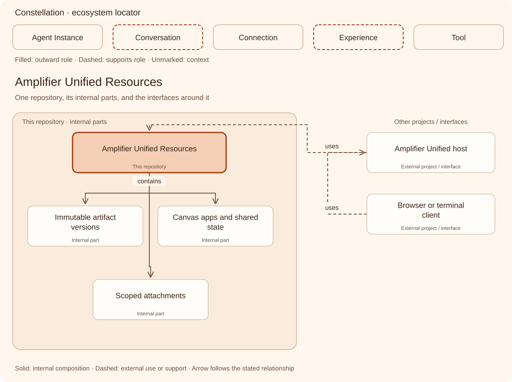

# Amplifier Unified Resources

Add shared Canvas artifacts, interactive Canvas apps, and attachments to an
[Amplifier Unified host](https://github.com/microsoft/amplifier-unified-host).
This package stores their contents and versions so clients can reopen, edit, and
share them across a conversation.

This is a library for developers composing a host. The browser or terminal client
provides the interface; this package provides storage and resource operations.

## Get started

Use Node.js 22.16 or later. From a checkout:

```sh
npm ci
```

Install the checkout into the project that composes your host:

```sh
npm install /absolute/path/to/amplifier-unified-capability-resources
```

Then create the capability with a private storage directory and the host's public
session inspector:

```js
import { createResourcesCapability } from '@amplifier/unified-resources-capability';

const resources = createResourcesCapability({
  directory: '/absolute/private/resources',
  inspectSession: (session) => host.inspectSession(session),
  onChanged: (topic, scope) => host.invalidateCapability(topic, scope),
});
```

Here, `host` is your configured host instance. Register the capability's
`manifest`, `read`, and `action` handlers, and **all** entries in
`resources.resourceProviders` so both Canvas and attachments are available. Pass
the host's authenticated context to actions, and call `resources.close()` when
shutting down. The [integration contract](docs/CONTRACT.v1.md) describes the
remaining responsibilities.

## What it provides

- Immutable artifact versions and conditional edits that detect conflicts.
- Interactive app definitions with separately versioned shared state.
- Attachment uploads and verified reads, scoped to the conversation.
- Registration of externally owned resources, including MCP app views.

Private drafts and unfinished edits stay with the client. Saving an artifact does
not overwrite its source file. Imports preserve historical data; they do not grant
permission to rerun work or client effects.

## Reference

- [Integration and behavior contract](docs/CONTRACT.v1.md)
- [Public entry point](src/index.js) and [action definitions](src/actions.js)
- [Attachment operations](src/attachments.js)

For local development, run `npm test`.


<!-- ecosystem-map:start -->
## Where this fits

Shared Canvas, app-state and attachment storage for a composed Amplifier Unified host.

Supports: Experience, Conversation.



[Open the map](docs/ecosystem-map.svg) · [Product page source (private)](docs/product/index.html) · [Map guide](https://github.com/microsoft/amplifier-constellation/blob/main/docs/ecosystem-maps.md)

<details>
<summary>The five shared building blocks</summary>

[](https://microsoft.github.io/amplifier-constellation/)

</details>

<!-- ecosystem-map:end -->

## Contributing

Most contributions require you to agree to a
Contributor License Agreement (CLA) declaring that you have the right to, and actually do, grant us
the rights to use your contribution. For details, visit [Contributor License Agreements](https://cla.opensource.microsoft.com).

When you submit a pull request, a CLA bot will automatically determine whether you need to provide
a CLA and decorate the PR appropriately (e.g., status check, comment). Simply follow the instructions
provided by the bot. You will only need to do this once across all repos using our CLA.

This project has adopted the [Microsoft Open Source Code of Conduct](https://opensource.microsoft.com/codeofconduct/).
For more information see the [Code of Conduct FAQ](https://opensource.microsoft.com/codeofconduct/faq/) or
contact [opencode@microsoft.com](mailto:opencode@microsoft.com) with any additional questions or comments.

## Trademarks

This project may contain trademarks or logos for projects, products, or services. Authorized use of Microsoft
trademarks or logos is subject to and must follow
[Microsoft's Trademark & Brand Guidelines](https://www.microsoft.com/legal/intellectualproperty/trademarks/usage/general).
Use of Microsoft trademarks or logos in modified versions of this project must not cause confusion or imply Microsoft sponsorship.
Any use of third-party trademarks or logos are subject to those third-party's policies.
